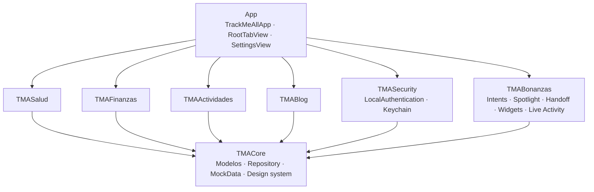

# trackMeAll

**Español** · [English](#english)

[](https://swift.org)
[](https://developer.apple.com/ios/)
[](#estado-de-verificación)
[](LICENSE)
[](https://github.com/Ch4rlos/trackMeAll/actions/workflows/ci.yml)

App iOS personal que concentra cuatro frentes en un solo lugar: **Salud**, **Finanzas**,
**Actividades** y **Blog**. SwiftUI, MVVM con `@Observable`, un paquete SPM por dominio,
seguridad biométrica real y datos mock mientras se define el backend.

Es también el proyecto con el que muestro cómo trabajo: arquitectura modular, decisiones
documentadas, límites de plataforma dichos de frente y pruebas que corren.

## Capturas

Las capturas en dispositivo se agregan al validar el build en simulador/iPhone.
El guion y el script para generarlas están en [`docs/CAPTURAS.md`](docs/CAPTURAS.md) y
[`scripts/capturas.sh`](scripts/capturas.sh).

## Arquitectura



Regla dura: **ningún paquete de sección se conoce entre sí**. Toda comunicación pasa por
`TMACore`. El detalle está en [`docs/ARQUITECTURA.md`](docs/ARQUITECTURA.md).

## Módulos

| Paquete | Responsabilidad | Estado |
|---|---|---|
| `TMACore` | Modelos, protocolos `Repository`, `MockData`, design system, hápticos | ✅ tests |
| `TMASalud` | HealthKit: Watch, alimentación, salud mental (`HKStateOfMind`) | mock |
| `TMAFinanzas` | Cuentas y movimientos (correo, OCR, CSV) | mock |
| `TMAActividades` | Uso de apps, lugares, agenda | mock |
| `TMABlog` | Publicaciones y multimedia (R2/S3) | mock |
| `TMASecurity` | Face ID / Touch ID, Keychain biométrico, pantalla de bloqueo | ✅ tests |
| `TMABonanzas` | App Intents, Spotlight, Handoff, widgets, Live Activity | código listo |

## Seguridad

- **Biometría con LocalAuthentication**: Face ID, Touch ID u Optic ID; el sistema evalúa,
  la app nunca ve tu rostro ni tu huella.
- **Auto-bloqueo** al mandar la app al fondo, con caída al código del dispositivo cuando
  la biometría se bloquea por intentos.
- **Keychain con `biometryCurrentSet`**: si se agrega o borra un rostro/huella, el secreto
  se invalida solo.
- **La app no maneja credenciales de servicios**: las firmas de subida viajan al backend
  (URLs prefirmadas, nunca llaves en el cliente).

## Límites de plataforma (dichos de frente)

| Quiero | ¿Se puede? | Camino real |
|---|---|---|
| Leer los SMS del banco | **No** | No existe API pública; se sustituye con correo (Gmail API), OCR on-device y CSV |
| Ver movimientos de Apple Wallet | **Parcial** | `FinanceKit` cubre Apple Card/Cash y exige entitlement gestionado + cuenta a nivel organización |
| Uso de apps del sistema | **Con permiso** | `DeviceActivity` + `Family Controls` (entitlement de Apple) |
| Historial de lugares | **Sí** | `CoreLocation` visit monitoring |
| Datos del Watch | **Sí** | `HealthKit` (requiere dispositivo que los genere) |

El detalle, con la cita de la documentación de Apple, está en
[`docs/ALCANCE-APPLE.md`](docs/ALCANCE-APPLE.md).

## Estado de verificación

| Qué | Cómo | Resultado |
|---|---|---|
| Tests de dominio (`TMACore`) | `swift test` en macOS | **5 passed** |
| Tests del bloqueo biométrico (`TMASecurity`) | `swift test` en macOS | **7 passed** |
| Compilación de los 7 paquetes | `swiftc -emit-module`, Swift 6, SDK iOS 26.5 | 0 errores, 0 warnings |
| Compilación del target de app | `swiftc -typecheck` con los 7 módulos | 0 errores |
| Ejecución en simulador | pendiente del componente *iOS 26.5 platform* en Xcode | — |
| Biometría, Keychain, widgets, Live Activity en runtime | pendiente de dispositivo | — |

## Cómo correr

```bash
brew install xcodegen
xcodegen generate
open trackMeAll.xcodeproj
```

Pruebas (no necesitan simulador):

```bash
swift test --package-path Packages/TMACore
swift test --package-path Packages/TMASecurity
```

Build por CLI (requiere el componente iOS instalado en Xcode):

```bash
xcodebuild -project trackMeAll.xcodeproj -scheme trackMeAll \
  -destination 'generic/platform=iOS Simulator' build
```

## Roadmap

- [x] Scaffold: 7 paquetes, 4 secciones con datos mock
- [x] Acceso biométrico, Keychain protegido y auto-bloqueo
- [x] App Intents, Spotlight, Handoff, widgets y Live Activity (código)
- [x] CI en macOS con build y tests
- [ ] Persistencia con SwiftData + `FileProtection` y migraciones versionadas
- [ ] Extensiones de WidgetKit y Live Activity en el target
- [ ] HealthKit real (lectura de Watch, sueño, ánimo)
- [ ] Finanzas: Gmail API + OCR con Vision
- [ ] Backend de blog con R2 (URLs prefirmadas)
- [ ] Capturas y GIF para este README

## Licencia

MIT — ver [`LICENSE`](LICENSE).

---

## English

Personal iOS app that brings four areas together: **Health**, **Finance**, **Activity**
and **Blog**. SwiftUI with MVVM and `@Observable`, one SwiftPM package per domain, real
biometric security, and mock data while the backend is defined.

**Verified**: 12 tests passing on macOS (`swift test`), all 7 packages and the app target
compile clean under Swift 6 against the iOS 26.5 SDK. Running in the Simulator is pending
an Xcode platform component download.

**Design rules**: feature packages never import each other (everything goes through
`TMACore`), repositories are protocols with injectable mocks, and no service credentials
ever live in the client — uploads use presigned URLs.

**Platform limits, stated plainly**: iOS has no public API to read SMS, `FinanceKit`
(Apple Card/Cash) requires a managed entitlement and an organization-level Apple Developer
account, and per-app usage requires the `Family Controls` entitlement. Those are documented
with Apple's own wording in [`docs/ALCANCE-APPLE.md`](docs/ALCANCE-APPLE.md).

MIT licensed.
